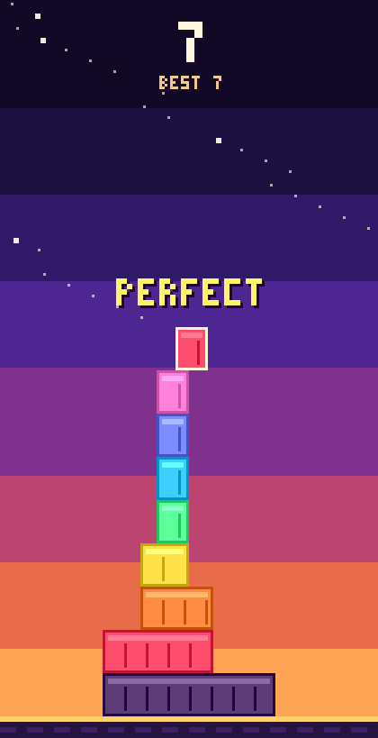

# Stack It 🎮

A one-tap pixel stacking game by StudioRApps.



# Play Now!

[](https://gituserc1140.github.io/stack-it/)

# Sponsor me!

[](https://github.com/sponsors/gituserc1140)

## How to Play

| Action | Mobile | Desktop |
|--------|--------|---------|
| Drop the block | Tap | Click / Space |
| Start / Restart | Tap | Click / Space |

- Land the **sliding block** on the tower. The overhang is sliced off, and the next block is only as wide as what stuck.
- A **perfect** drop snaps the block flush with the one below it.
- Miss the tower and the run ends. Tap, click, or press space to play again.
- The block speeds up as the stack grows. Your **best** score stays on this device.

## Project Structure

```
/docs
  index.html    – game shell
  styles.css    – full-screen dark pixel theme
  game.js       – loop, input, stacking, and scoring
  gameplay.png  – gameplay screenshot
```

## Running Locally

Open `docs/index.html` directly in any modern browser, or serve the `/docs` folder with a local HTTP server:

```bash
# Python 3
python3 -m http.server 8080 --directory docs
# Then open http://localhost:8080
```

## Deploy to GitHub Pages

1. Push this repository to GitHub.
2. Go to **Settings → Pages**.
3. Set **Source** to `Deploy from a branch`, branch `main`, folder `/` (root).
4. Save – GitHub Pages will publish the game at `https://gituserc1140.github.io/stack-it/`.

The root `index.html` automatically redirects visitors to `./docs/`, so both the root URL and the `/docs/` URL open the game.

## Technical Notes

- Pure HTML5 Canvas pixel art – no external libraries or frameworks.
- Blocks are drawn on an integer grid with smoothing off, so the pixels stay sharp.
- Tap, click, and space are one action: drop the block, start, or restart.
- Touch moves call `preventDefault` so the page does not scroll while you play.
- The best score is kept in `localStorage` on this device.
